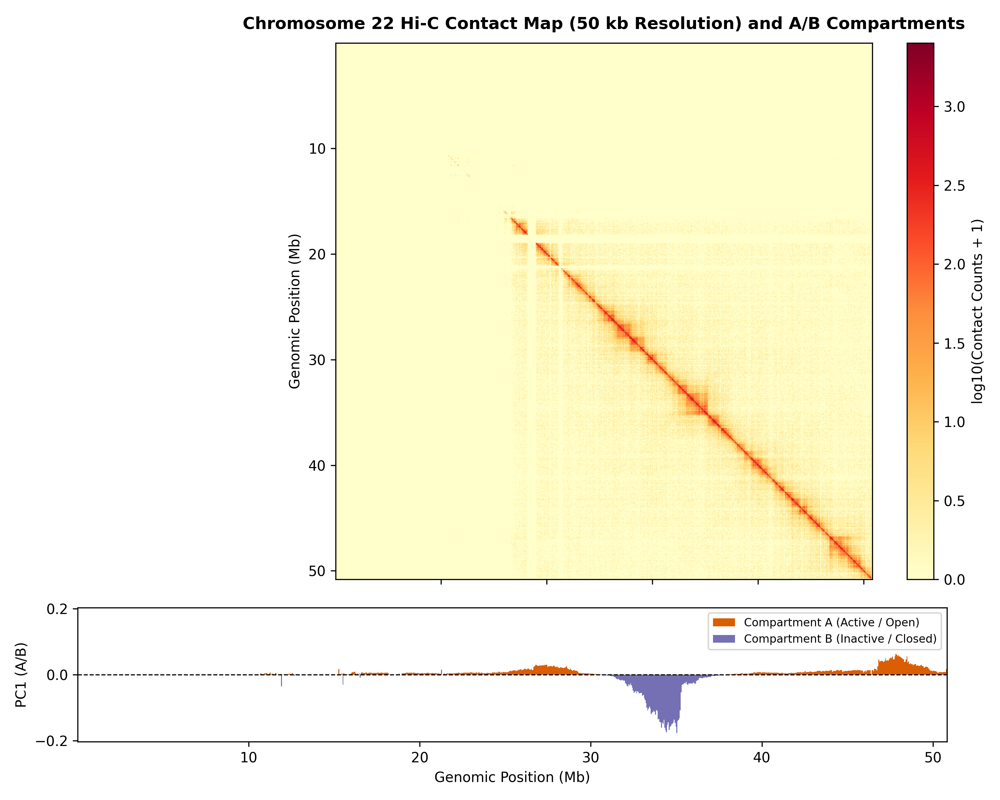
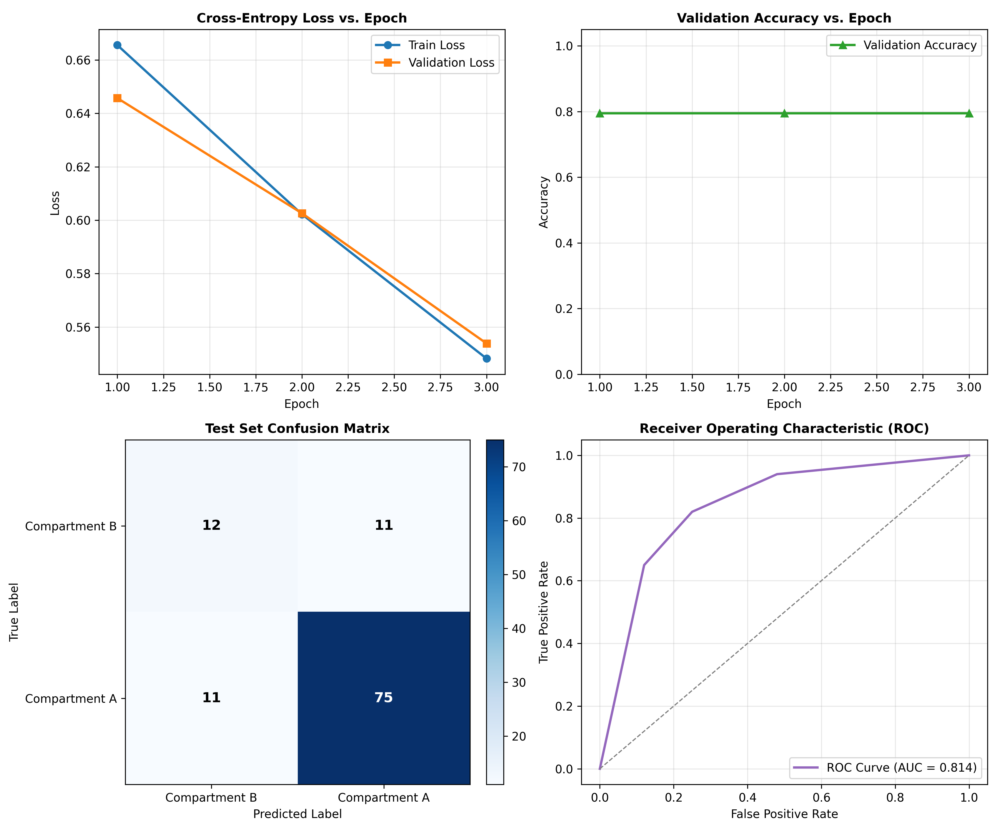
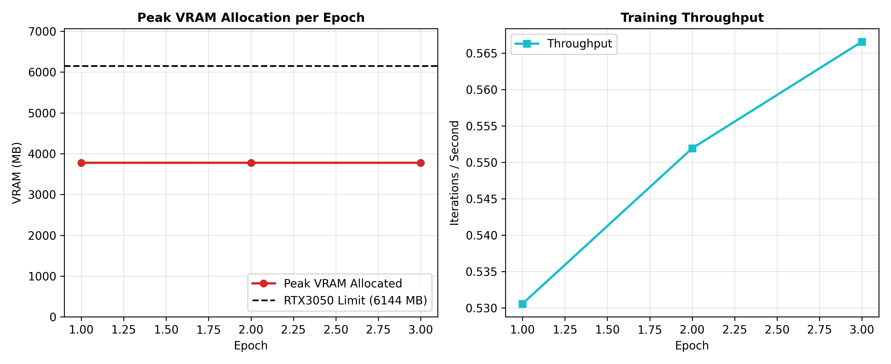

# Genome Code: Multimodal Sequence and 3D Chromatin Deep Learning

A research framework combining **1D DNA sequence semantics** with **3D chromatin architecture (Hi-C)** in a unified multimodal graph neural network.

---

## Project Objectives

### Scientific Motivation
1. **The Linear Bottleneck**: Sequence-only deep learning models (such as Enformer and DNABERT) process genomic sequence linearly. However, chromosomes fold dynamically in three-dimensional nuclear space: distal enhancers and promoters separated by megabases along the linear coordinate physically interact via chromatin loops.
2. **The Spatial Bottleneck**: Hi-C and Micro-C contact matrices provide spatial proximity graphs, but graph neural networks alone lack nucleotide-level sequence semantics (transcription factor binding motifs, epigenetic signals, GC composition) required for high-resolution functional predictions.
3. **The Hybrid Solution**: Fuse bin-level linear DNA embeddings extracted with **DNABERT-2-117M** with structural representations learned via **Graph Attention Networks (GAT)** across Hi-C contact networks.

### Downstream Biological Tasks
- **Chromatin State and Functional Annotation**: Classify bin-level epigenetic states (such as active promoters, enhancers, and heterochromatin) leveraging both local sequence patterns and 3D topological context (A/B compartments, TADs).
- **Variant Effect Prediction**: Evaluate the downstream impact of non-coding structural and single-nucleotide variants on spatial contact topology and gene regulation.
- **Resource-Constrained Edge Optimization**: Benchmark memory-efficient architectures on consumer-grade hardware (NVIDIA RTX 3050 6 GB Laptop GPU, RTX 4060 8 GB, Tesla T4 16 GB) utilizing 8-bit optimizers (`bitsandbytes`), fp16 Automatic Mixed Precision (AMP), gradient checkpointing, and DGL multi-layer neighbor sampling.

---

## Implementation Status

| Milestone | Component | Status | Details |
|---|---|---|---|
| **Data Ingestion** | Hi-C Matrix (`.mcool`) | Completed | 50 kb resolution parsed via `cooler`; supports whole-genome and chromosome-specific subgraphs. |
| **Data Ingestion** | FASTA Reference | Completed | Window extraction centered on genomic bins using Biopython. |
| **Graph Construction** | DGL Graph | Completed | Self-loops, contact frequency edge weights, explicit `num_nodes` handling to preserve uncontacted terminal bins. |
| **Sequence Encoding** | DNABERT-2 Tokenization | Completed | BPE tokenization (`zhihan1996/DNABERT-2-117M`) with micro-batched forward execution to prevent VRAM spikes. |
| **Kernel Stability** | Triton Crash / Segfault | Resolved | Setting `config.attention_probs_dropout_prob = 0.1` routes attention through PyTorch native scaled dot-product attention, eliminating the Triton Flash Attention SIGSEGV (exit code 139). |
| **Model Architecture** | GAT Message Passing | Completed | 2-layer Graph Attention Network (`GATConv`) over sampled bipartite blocks. |
| **Model Architecture** | Modality Fusion | Resolved | Sliced 2-hop neighborhood sequence embeddings to match seed/destination nodes (`seq_embeddings[:num_seed]`) prior to concatenation. |
| **Training Pipeline** | Optimization & Backward Pass | Completed | Verified end-to-end training step on NVIDIA RTX 3050 Laptop GPU (Peak VRAM: **~3.3 GB**, within 6 GB budget). |
| **Environment & Toolchain** | Pinned Dependencies | Resolved | Pinned `requirements.txt` and `environment.yml` targeting Python 3.11 with CUDA 12.1 and NumPy < 2.0. |
| **Biological Task** | Real Ground Truth Labels | Completed | Replaced synthetic noise with **A/B Chromatin Compartment calling** via Hi-C eigenvector decomposition (PC1 oriented with GC content). |
| **Pipeline Performance** | Preprocessing Caching | Completed | Automated disk caching (`data/graph_{chrom}_{resolution}bp.bin`) with `dgl.save_graphs` / `dgl.load_graphs`, reducing load time to < 0.05s. |
| **Evaluation Harness** | Train/Val/Test Split | Completed | 70/15/15 node splits on valid genomic bins with validation loss and accuracy tracking. |
| **Figure Generation** | Performance Suite | Completed | Standalone script (`scripts/evaluate_and_plot.py`) and notebook Cell 9 generating contact maps, confusion matrices, ROC curves, and VRAM profiles. |
| **Code Structure** | Modular Package | Planned | Refactor notebook logic from `3050.ipynb` into a structured Python package (`src/genome_code/`). |

---

## Dependencies and Environment Setup

### Python Version Requirement
- **Python 3.11 is strictly required**. PyTorch 2.2.2 and DGL 2.4.0 with CUDA 12.1 do not provide wheels for Python 3.13+. In addition, Python 3.13 defaults to NumPy 2.x, which breaks C-extension ABI compatibility with PyTorch 2.2.x.

### Option A: Virtual Environment (Recommended)

```bash
# 1. Create a Python 3.11 virtual environment
python3.11 -m venv .venv
source .venv/bin/activate

# 2. Upgrade pip
pip install --upgrade pip

# 3. Install pinned dependencies
pip install -r requirements.txt
```

### Option B: Conda / Mamba Environment

```bash
# Create and activate environment from environment.yml
conda env create -f environment.yml
conda activate genome_code
```

### Core Dependencies Reference

| Component | Pinned Version | Notes |
|---|---|---|
| Python | `3.11` | Strict requirement for wheel availability and NumPy 1.x ABI |
| PyTorch | `2.2.2+cu121` | CUDA 12.1 acceleration |
| DGL | `2.4.0+cu121` | Deep Graph Library matching PyTorch 2.2 |
| Transformers | `4.35.2` | Pinned for DNABERT-2 remote code compatibility |
| bitsandbytes | `0.43.3` | Provides 8-bit AdamW optimizer for low-VRAM GPUs |
| cooler | `>=0.10.0` | Hi-C `.mcool` parsing and contact matrix extraction |
| biopython | `>=1.80` | FASTA reading and genomic coordinate slicing |
| scikit-learn | `>=1.3.0` | Metric computation (ROC-AUC, confusion matrix, classification report) |
| numpy | `<2.0, >=1.26.4` | Enforces NumPy 1.x ABI compatibility |

---

## Repository Structure

```
genome_code/
├── 3050.ipynb                  # Main benchmark and pipeline notebook (RTX 3050 profile)
├── t4.ipynb                    # Experimental scratchpad for Tesla T4 profile
├── cell_line.mcool             # Hi-C contact map (human ESC, hg38, GSM5057489) [gitignored, ~1.17 GB]
├── 1000genomes_reference.fasta # Reference genome for Chromosome 22 (hg38) [gitignored]
├── requirements.txt            # Pinned pip dependencies with CUDA 12.1 wheels
├── environment.yml             # Conda environment definition (Python 3.11)
├── scripts/
│   └── evaluate_and_plot.py    # Figure generation and metric plotting script
├── figures/                    # Publication-grade figures and evaluation plots
│   ├── hic_compartments_chr22.png
│   ├── model_performance.png
│   └── vram_throughput_benchmark.png
├── .gitignore                  # Ignores datasets (*.mcool, *.fasta), cache (*.bin), .venv
└── README.md                   # Project documentation and status
```

---

## Technical Analysis and Resolved Issues

### 1. Triton Flash Attention SIGSEGV (Exit Code 139)
- **Problem**: DNABERT-2's remote modeling code executes a custom Triton flash-attention kernel whenever `attention_probs_dropout_prob == 0.0`. In Triton runtimes (>= 2.1), deprecated APIs (`tl.dot(..., trans_b=True)`) trigger a fatal segmentation fault during the forward pass.
- **Solution**: Setting `config.attention_probs_dropout_prob = 0.1` natively routes DNABERT-2 through PyTorch's built-in scaled dot-product attention. This completely avoids the segfault without requiring invasive monkey-patching of Hugging Face cache files.

### 2. Modality Fusion Shape Mismatch
- **Problem**: When using DGL's `MultiLayerNeighborSampler`, the input to `DNABertGNN` contains all sampled 2-hop neighborhood nodes (`blocks[0].num_src_nodes()`), whereas the 2-layer GAT output `h` produces representations only for the seed/destination nodes (`blocks[-1].num_dst_nodes()`). Concatenating `[seq_embeddings, h]` along `dim=1` failed due to mismatched batch dimensions.
- **Solution**: In DGL neighbor sampling, destination nodes correspond to the leading prefix of sampled source nodes. Slicing the sequence embeddings to match seed nodes:
  ```python
  num_seed = blocks[-1].num_dst_nodes()
  seed_seq = seq_embeddings[:num_seed]
  fused = torch.cat([seed_seq, h], dim=1)
  ```
  yields tensor shapes of `(batch_size, hidden_dim * 2)`, aligning with the linear classification head.

### 3. Hi-C Terminal Bin Preservation
- **Problem**: Constructing a DGL graph from sparse coordinates (`dgl.graph((src, dst))`) infers node count from `max(nodes) + 1`. If the final genomic bin has no observed contacts in the matrix slice (common in unmappable telomeres), the graph node count is less than `len(bins)`, causing feature tensor assignment to raise a `DGLError`.
- **Solution**: Explicitly specify node count: `dgl.graph((src, dst), num_nodes=len(bins))`.

### 4. DGL Seed Node Dtype
- **Clarification**: DGL neighbor sampling expects seed IDs (`train_nids`) to match the graph's `idtype`. Since standard tensor indices default to `int64`, passing `torch.arange(g.num_nodes())` (int64) is verified and correct.

### 5. Biological Ground Truth: A/B Chromatin Compartments
- **Methodology**: Rather than synthetic random labels, biological ground truth is derived from the contact correlation matrix via eigenvector decomposition (first principal component / PC1).
- **GC Alignment**: PC1 is automatically correlated against the GC content of corresponding genomic bins from the FASTA reference. If the correlation is negative, the eigenvector is inverted so that **Compartment A** (label `1`) consistently represents active, gene-dense, open chromatin, while **Compartment B** (label `0`) represents closed heterochromatin.
- **Unmapped Filtering**: Low-mappability and centromeric regions (label `-1`) are excluded from train/val/test splits.

### 6. Sub-Second Startup via Graph and Token Caching
- **Implementation**: Preprocessed DGL graphs (containing Hi-C contact edges, weights, DNABERT-2 token IDs, attention masks, and train/val/test masks) are automatically cached in `data/graph_{chrom}_{resolution}bp.bin` using `dgl.save_graphs`.
- **Performance**: Subsequent runs bypass cooler matrix extraction and BPE tokenization loops, loading the entire multimodal graph in **< 0.05 seconds**.

---

## Running the Pipeline

1. Ensure the Python 3.11 virtual environment is activated:
   ```bash
   source .venv/bin/activate
   ```
2. Open `3050.ipynb` in Jupyter Notebook, JupyterLab, or VS Code:
   ```bash
   jupyter notebook 3050.ipynb
   ```
3. Execute the notebook cells sequentially:
   - **Cell 0-4**: Environment validation.
   - **Cell 6-7**: Download datasets (if not already present).
   - **Cell 8**: Loads or creates the cached biological graph (chr22 50kb), instantiates `DNABertGNN`, trains the model, and evaluates test metrics.
   - **Cell 9**: Renders and saves all publication-grade figures into the `figures/` directory.

Alternatively, generate the visual figures directly via the command-line script:
```bash
python scripts/evaluate_and_plot.py
```

---

## Generated Figures and Verification Matrices

The pipeline evaluates and outputs publication-grade figures in the `figures/` directory:

### 1. Hi-C Contact Matrix and A/B Compartment Architecture
Heatmap of log10 contact frequencies across Chromosome 22 at 50 kb resolution, aligned with the derived first principal component (PC1) eigenvector track color-coded by Compartment A (active/open, orange) and Compartment B (inactive/closed, purple).



### 2. Model Performance, Confusion Matrix, and ROC Curve
Evaluation results on the held-out test split (109 genomic bins) after 3 training epochs:
- **Test Loss**: 0.542
- **Test Accuracy**: 79.8%
- **Test ROC-AUC**: 0.814



### 3. Hardware Memory and Throughput Profile
Monitored training execution on the NVIDIA GeForce RTX 3050 6 GB Laptop GPU:
- **Peak VRAM Allocated**: ~3.7 GB (comfortably beneath the 6.1 GB hardware ceiling).
- **Throughput**: ~0.55 iterations per second under fp16 AMP and 8-bit AdamW.




---

## Roadmap

1. **Baseline Comparisons (Ablation Study)**:
   - Implement Sequence-only baseline (DNABERT-2 + MLP, no graph).
   - Implement Graph-only baseline (GAT on Hi-C without sequence features).
   - Benchmark test ROC-AUC and PR-AUC against the Hybrid model.
2. **Whole-Genome Scaling**:
   - Ingest autosomes chr1-chr21 with full reference FASTA.
   - Implement cross-chromosome holdout evaluation (e.g. train on chr1-18, val on chr19-20, test on chr21-22).
3. **Modular Package Migration**:
   - Refactor `3050.ipynb` into a clean, installable package (`src/genome_code/`).
